<!-- Custom Animated Bangladeshi Cyber Banner -->

 

<!-- Single-line Animated Typing SVG (clean width so nothing clips) -->

<!-- Profile Views + Social & Channel Badges -->

  
  
  
  
  

<!-- Custom Animated Terminal HUD -->

  

## 🚀 Featured W8Team Projects

| Project | Focus | Stack | Link |
|:---|:---|:---|:---:|
| **⚡ W8Core-Termux-Modedd** | Termux power-core & AI/dev tool installer | `Bash` `Shell` | [Explore →](https://github.com/WaitVai/W8Core-Termux-Modedd) |
| **☤ W8HermesAgentTermux** | Self-evolving Hermes AI Agent for Android (Termux) | `Bash` `Python` `Node` | [Explore →](https://github.com/WaitVai/W8HermesAgentTermux) |
| **🔀 W8OmniRouteTermux-Modedd** | OmniRoute Termux-modded AI routing & proxy suite | `TypeScript` `Node.js` | [Explore →](https://github.com/WaitVai/W8OmniRouteTermux-Modedd) |
| **🛡️ W8FridaAutoInstaller** | Automated Frida & SSL unpinning suite for rooted Termux | `Python` `Frida JS` | [Explore →](https://github.com/WaitVai/W8FridaAutoInstaller) |
| **📷 W8CameraScannerV1** | Multi-threaded IP range & RTSP camera detector | `Python` | [Explore →](https://github.com/WaitVai/W8CameraScannerV1) |
| **⚔️ W8StrykerOSS** | Open-source security & testing utilities | `OSS` | [Explore →](https://github.com/WaitVai/W8StrykerOSS) |

 

## 🛠️ Tech Arsenal

  

  

## 📊 Live GitHub Telemetry

  

 

  

## 🐍 Contribution Snake

  <picture>
    <source media="(prefers-color-scheme: dark)" srcset="https://raw.githubusercontent.com/WaitVai/WaitVai/output/github-contribution-grid-snake-dark.svg" />
    <source media="(prefers-color-scheme: light)" srcset="https://raw.githubusercontent.com/WaitVai/WaitVai/output/github-contribution-grid-snake.svg" />
    
  </picture>

 

  

## 🌐 Connect with W8Team

| Platform | Handle / Channel | Link |
|:---|:---|:---:|
| 💬 **Telegram (Personal)** | `@W8SOJIB` | [Message](https://t.me/W8SOJIB) |
| 📢 **Telegram Channel 1** | `@W8TeamNew` | [Join](https://t.me/W8TeamNew) |
| 📢 **Telegram Channel 2** | `@W8Teams` | [Join](https://t.me/W8Teams) |
| ▶️ **YouTube** | `@w8teams` | [Subscribe](https://www.youtube.com/@w8teams) |

 

<!-- Custom Animated Bangladeshi Wave Footer -->

